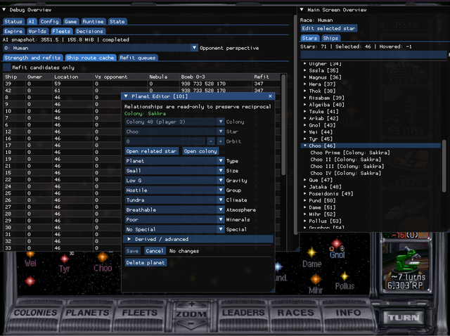

# Internal debugger

The internal debugger is an optional testing and experimentation tool. It is not needed for normal play and is disabled by default.

## Enable and open it

Add this setting to `data/orion2re.cfg`, then restart the game:

```text
interface debugger_enabled = true;
```

Press F10 to show or hide the debugger. While it is visible, it captures keyboard and mouse input so that clicks and keys do not also control the game. Press F10 again to return to normal play.

While the debugger is enabled, F10 controls the debugger instead of saving to the automatic-save slot. Custom builds without debugger support retain the normal F10 save action.

## What it can do

The debugger can inspect general game and AI state, configuration and runtime information, stars and planets, players and diplomacy, colonies and ships, leaders and events, and tactical combat. Some information is read-only. Other panels offer editors for values such as resources, research, relationships, colony production, fleets, leaders, events, and combat entities. The available panels depend on the current game state.



Some editors keep changes in a draft until they are applied. Cancel or close one of these editors to discard its draft, or use its reload action to restore the current live values. Other controls change the running game immediately.

## Risks

Edits take effect in the running game and can create combinations that ordinary play never produces. They can change scoring, invalidate assumptions made by the AI, or make a save difficult to continue. Do not use the debugger in a valued game without first keeping a separate save.

An applied edit has no general undo. Hiding or disabling the debugger does not reverse it, and saving can preserve it. If an unwanted change has already been applied, quit without saving or return to the main menu and load a save from before the edit.

Avoid all debugger edits in multiplayer. Network games disable several changes, but controls that remain available can still leave participants with different state. Ordinary reconnection to a running network game is not supported.

To disable the tool, remove the setting or set it to `false`, then restart the game.