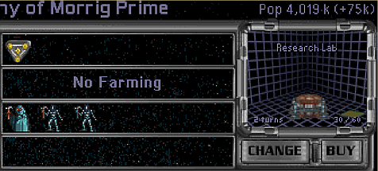

# Manual: Population growth

Population grows fastest on a colony that has room to expand. As the colony approaches its population limit, natural growth slows. Housing converts net industry into a growth bonus, while a Cloning Center adds growth after the normal calculation.

## Population Capacity

A planet's population capacity starts with its size and climate. The default values are:

| Planet size | Tiny | Small | Medium | Large | Huge |
| --- | ---: | ---: | ---: | ---: | ---: |
| Size capacity | 5 | 10 | 15 | 20 | 25 |

| Climate | Toxic | Radiated | Barren | Desert | Tundra | Ocean | Swamp | Arid | Terran | Gaia |
| --- | ---: | ---: | ---: | ---: | ---: | ---: | ---: | ---: | ---: | ---: |
| Capacity | 25% | 25% | 25% | 25% | 25% | 25% | 40% | 60% | 80% | 100% |

For each race, the game calculates the limit in this order:

1. Aquatic treats Tundra and Swamp as Terran, and Ocean and Terran as Gaia. With `colony aquatic_treats_tundra_as_swamp = true;`, Tundra is treated as Swamp instead.
2. Tolerant adds 25 percentage points to the climate capacity, up to 100%.
3. Multiply the size capacity by the resulting climate percentage and round the result to the nearest whole population unit.
4. Subterranean adds 2 population per planet-size step: +2 on Tiny through +10 on Huge.
5. Advanced City Planning adds 5 if known, and Biospheres adds 2 if present on the colony.

The displayed colony limit cannot exceed 42. On a colony containing several races, the greatest applicable limit among the races present is displayed, but each race remains subject to its own capacity when another population unit is admitted. This matters when Subterranean and non-Subterranean races share a colony.

### Optional capacity tables

Set `colony population_capacity_table_enabled = true;` to replace the base capacity formula with direct climate-by-size lookups. The default is `false`, preserving existing mods and their size, climate, and Tolerant percentage settings.

`colony population_capacity_table` supplies normal capacities; `colony population_capacity_table_tolerant` supplies capacities for Tolerant races and Androids. Both tables default to the classic formula results. Each climate row contains Tiny, Small, Medium, Large, and Huge values in that order. For example:

```cfg
colony population_capacity_table_enabled = true;
colony population_capacity_table gaia = 5 10 15 20 25;
colony population_capacity_table terran medium = 12;
colony population_capacity_table_tolerant toxic small = 5;
```

Aquatic selects the adjusted climate row before lookup, including for Aquatic + Tolerant races. Subterranean, Advanced City Planning, and Biospheres still add their bonuses afterward, and the final colony limit remains capped at 42. The `pop_bonus tolerant` percentage is ignored in table mode. Radiation shields and the configured Toxic-conversion building continue to change the colony's effective climate before capacity is calculated.

Legacy `population_capacity size` settings still govern Artificial Planet initialization and absolute infantry and tank limits; the new tables do not replace those settings.

## Definitions

| Symbol | Meaning | Default or notes |
| --- | --- | --- |
| `POPRACE` | Population of the race being considered | Calculated separately for each race on the planet. |
| `POPAGG` | Total population of the planet | Includes `POPRACE`, annexed population, natives, and droids. |
| `POPMAX` | Maximum population of the planet | Uses the applicable population capacity. |
| `PROD` | Colony net industry after maintenance | Used only for Housing. |
| `FACTOR1` | Basic growth factor | 2000 by default. |
| `FACTOR2` | Housing growth factor | 40 by default. |
| `g` | General growth bonus | 0 by default. |
| `r` | Racial growth bonus | -50% growth is `-50`, +50% is `50`, and +100% is `100`. |
| `i` | AI growth bonus | 0-4, based on difficulty level. |
| `t` | Technology growth bonus | Microbiotics is `25`; Universal Antidote is `50`. |
| `l` | Leader growth bonus | Only the best Medicine bonus applies. |
| `e` | Event growth bonus | Population Boom is `+100`; plague is `-200`.* |
| `h` | Housing growth bonus | Calculated from net industry and population. |

## Growth Formula

Population growth is calculated separately for each race on a planet. In multiracial colonies, the population value displayed in the Colony screen is the sum of all growth rates added to the number of functioning population units and therefore becomes less directly indicative of the time to gain a next full population unit.



The formula for the basic growth of a race (a) is:

> `a = trunc[(FACTOR1 * POPRACE * (POPMAX - POPAGG) / POPMAX)^0.5]`

The default value of FACTOR1 can be modified with `colony growth_formula_factor`.

`a` is truncated (rounded down) before it is multiplied by the combined growth multiplier `b`:

> `b = (100 + g + r + i + t + l + e + h) / 100`

If all seven bonuses are zero, then `b` is 1.

The general bonus (g) is applied to all players in the game and can be set with `colony growth_rate_bonus general_modifier`, which is 0 by default.

The growth bonuses from the technologies (t) Microbiotics and Universal Antidote can be set individually with `colony growth_rate_bonus microbiotics_tech` and `colony growth_rate_bonus antidote_tech`. By default the bonuses from these two technologies do not stack. Enable stacking with `colony cumulative_growth_tech_bonuses = true;`.

The formula for housing (h) is:

> `h = FACTOR2 * PROD / POPAGG`

Obviously this only applies when you are housing. The default value of FACTOR2 is 40, which can be set with `colony housing_formula_factor`. POPAGG can be removed from the formula with `colony housing_no_popagg = true;`.

The product `a * b` is truncated again, after which the Cloning Center growth bonus is added.

Occupation, starvation, and AI difficulty can apply additional adjustments. Mods with population-growth rules can also alter the final result.

*Note:* Since plague is part of the growth formula, plague itself causes no loss at maximum population because basic growth is then zero. Existing starvation or conquest penalties can still make the colony lose population.

## Cloning Center

The standard bonus of cloners is +100k. The bonus is divided according to each player race's share of the colony's total population. Natives, droids, and races that cannot grow still count in the total-population denominator, so part of the potential bonus can be unavailable. For each player race:

> `c = cloning bonus * (POPRACE / POPAGG)`

If there is only one race on the colony, then POPRACE = POPAGG and the full bonus is applied to that one race. If a race cannot grow, then its share of growth is lost.

Examples:

1. On a new colony with 3 natives and one colonist, only the colonist's one-quarter share is available, resulting in net Cloning Center growth of +25k under the default bonus.

2. On a colony with 1 droid and 1 regular pop, Cloners’ net bonus is +50k.

3. On a colony with mixed races, Cloners’ bonus will be lower than +100k if there is a non-subterranean race that cannot grow anymore and a subterranean race that still can.

The growth bonus provided by Cloning Center can be set with `colony cloning_center_growth_bonus` up to a maximum bonus of 127 (default is 100).

## Moving population between colonies

The Colonies screen can move a population unit from a world where farming is unavailable and assign it to farming at a destination where farming is allowed. Job capacity is checked at the destination; the source colony's inability to farm does not prevent the transfer.

Normal transfer restrictions still apply. You cannot move the source colony's last population unit or transfer natives. Blockades, space anomalies, plague, available freighters, and the number of populations already in transit can also prevent a transfer.
