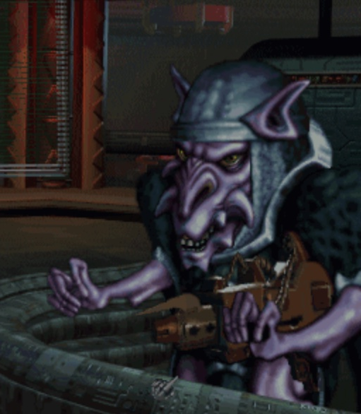

# Manual: Raiding and orbital assault

Raiding lets boarding marines damage a ship or kill its defenders without immediately capturing it. Orbital bombardment instead converts the surviving fleet's weapons into an estimate of attacks against a colony.

## Raiding

The game calculates both players' ground-combat bonuses, then rolls from 1 through 100 for each side and adds the rolls to those bonuses. Marine hit points do not enter this comparison, so Heavy-G does not improve a marine's raid roll.

1. If the attack value is 20 higher than the defense value, the attacker inflicts 50 damage to up to two internal systems (weapons, special systems, shield generator, computer, drive). Unlike weapons damage, raid damage is not carried over once 2 internals are destroyed. Example: If internal-1 has 10 hp, and internal-2 has 20 hp, then both are destroyed and the remaining 20 damage points are lost.
2. If the attack value is 50 higher than the defense value, the attacker also kills one defender.
3. If the defense value is 50 higher, then the defender kills one attacker.



This process is repeated for every attacking marine. Each successful component-damage result makes the configured number of separate selections. Under the default rule, two components are selected and each can take up to 50 damage; the same component can be selected twice, and unused damage from one selection is not carried to another.

The number of defenders does not change defensive strength, component damage, or the chance that an attacker is killed. Even with no defending marines, the ship's defense bonus still opposes raids. Defender count matters only when a result would kill a defender: no defender can be lost once none remain.

The damage and number of selections are configurable:

```text
combat boarding raid_damage_per_marine = 50;
combat boarding raid_items_per_marine = 2;
```

Each weapon has `space / 10` hit points, with a minimum of 1. An eligible special system uses `space / 10`, with a minimum of 1, and then gains 1 additional hit point, giving eligible specials a minimum of 2. Battle Pods, Extended Fuel Tanks, Heavy Armor, Quantum Detonator, and Reinforced Hull have no raid hit points and cannot be selected for raid damage. Regeneration is also outside the initialized range of raid-damage specials. Shield generators, computers, and drives use hull-specific hit-point values instead.

Weapon hit points are stored as a total for the slot rather than for each weapon. From the slot's hit points and the size of one weapon, the game determines how many weapons still work. As a result, only one weapon in a slot can be partially damaged: the top weapon in the stack.

---

## Orbital assault

If you attack an enemy’s colony world that has no defenses present or if you win the combat that results from it, your fleet gains control of the orbital space around the planet. This gives you the opportunity to assault the colony itself. One of the choices you can have in the Orbital Combat Selection window is to bombard the colony.


## Orbital bombardment


### Estimated bomb hits

The Orbital Combat Selection window estimates the effect of bombardment without requiring ten tactical turns. The remaining ships simulate ten turns of fire, limited by ammunition and weapon recharge time. The displayed estimate is:

> `estimated bomb hits = trunc(structure maximum / civilian armor of the defender's best armor technology)`

Civilian armor is 100 for every armor technology under the default rules, so the default estimate divides the accumulated structure value by 100. Mods can change these armor values.

Only the attacker's active combat ships at the colony's star contribute to this estimate. Support ships, inactive ships, and ships elsewhere do not contribute. Strategic combat uses a separate three-round bombardment calculation and converts structural damage to colony hits at a rate of one hit per 40 damage.

Note:

- In the tactical estimate, damage near 32,000 structure produces a displayed value near 320 under the default civilian-armor rules. This is an effect of the tactical structural-damage threshold, not a separate hard cap. Strategic bombardment uses its separate three-round calculation and can produce a different limit.
- Damage from beams and torpedoes is halved as it is in tactical combat.
- A better computer helps for beams here too.
- A planet with the default regular crew contributes 7 points of missile defense after the crew bonus is halved. Scanners, ECCM, traits, fleet bonuses, and special weapons can change the resulting missile or torpedo miss chance.


### Bomb and fighter ammunition

Bombs receive enough ammunition for ten attacks during the simulation, while fighters make one launch. The simulation also uses the best available fighter or bomb weapon rather than always using the base weapon.


### Planet hits

| Target | Hits represented | Notes |
| --- | ---: | --- |
| Each eligible building | 1 | The Capitol and orbital-defense buildings are not eligible by default. |
| Stored production, if greater than 0 | 1 | More stored production increases its chance of being selected. |
| Each full population unit | 1 | - |
| Each marine | 1 | Modified by Heavy-G and Powered Armor. |
| Each tank | 2 | Modified by Heavy-G and Battleoids. |

Stored production is one eligible target whenever any production is stored. Planetary damage is resolved by selecting among the colony's eligible buildings, population, production, marines, and tanks rather than giving every listed item an independent fixed chance to be hit. The Capitol and orbital-defense buildings are not eligible building targets under the default rules.
