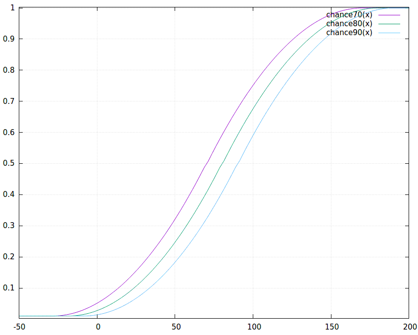
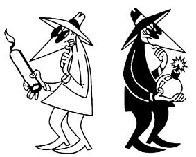

# Manual: Spying

Spies assigned to another empire can steal technology, sabotage colonies, or hide. Agents assigned at home oppose enemy operations. More operatives improve the relevant bonus, but every operation also depends on opposing bonuses and random rolls.

## Spy Bonuses

Every Spy you train can fulfill one of two functions. (1) On a mission, your spy goes off into the colonies of a race of your choice and tries to steal technologies, attempts to destroy enemy buildings or hides awaiting new orders. Any spy's success is noticed by the target race and has an adverse effect on relations, unless you are able to frame another race for your actions. (2) As an Agent, your operative roams inside your empire, ferreting out enemy spies and eliminating them.

You can train up to 63 defensive agents and 63 spies per opponent. Though not shown on the Races screen, each spy increases the bonus for the specific slot he is assigned to: The first five spies add 2 points each, and spies 6 to 10 add 1 point each. Subsequently, each pair of spies adds 1 point to the bonus. So with spy 11 the bonus is still +15 while spy 12 brings it up to +16. The maximum bonus is +41 for 62 or 63 spies.

Total spying bonus per slot is the sum of racial, governmental, leader and technology bonuses plus the bonus from the spies assigned to it. Bonuses are:

| Source | Bonus | Defense | Offense |
| --- | --- | ---: | ---: |
| Government | Feudalism | 0 | - |
| Government | Confederation | 0 | - |
| Government | Dictatorship | 10 | - |
| Government | Imperium | 15 | - |
| Government | Democracy | -10 | - |
| Government | Federation | -10 | - |
| Government | Unification | 15 | - |
| Government | Galactic Unification | 15 | - |
| Race | Spy -3 picks | -10 | -10 |
| Race | Spy +3 picks | 10 | 10 |
| Race | Spy +6 picks | 20 | 20 |
| Race | Telepathic | 10 | 10 |
| Technology | Neural Scanner | 10 | 10 |
| Technology | Telepathic Training | 5 | 5 |
| Technology | Cyber Security Link | 10 | 10 |
| Technology | Stealth Suit | 10 | 10 |
| Technology | Psionics | 10 | 10 |
| Leader | Telepath | 2 to 18 | - |
| Leader | Spy Master | - | 2 to 18 |
| Assigned operatives | Agents | 0 to 41 | - |
| Assigned operatives | Spies | - | 0 to 41 |

## Assassins

Before any spy activity happens, assassins get a chance to act. The chance to assassinate an enemy spy depends on a leader’s skill level and varies from +2% to +18% per turn.

## Roll Chance

To have any chance for stealing and sabotage, at least one spy needs to be sent to the opponent. On the other hand, defenses against enemy spies are active (and enemy spies can be killed) even with zero defending agents.

### Action Thresholds

For offensive spies to be successful a threshold needs to be overcome that consists of the defender's bonus (DB) and an action threshold (T). Default action thresholds are:

| Outcome | Threshold (`T`) |
| --- | ---: |
| Steal technology | 80 |
| Steal technology and frame another race | 90 |
| Sabotage | 70 |
| Sabotage and frame another race | 90 |

### Definitions

| Symbol | Meaning | Default or range |
| --- | --- | --- |
| `T` | Action threshold | Depends on the requested outcome. |
| `DB` | Defender's total spying bonus | Government, race, technology, leader, and assigned-agent bonuses. |
| `AB` | Attacker's total spying bonus | Race, technology, leader, and assigned-spy bonuses. |
| `E` | Effective threshold | Calculated from `T`, `DB`, and `AB`. |
| `AR` | Attacker roll | 1 through 100 by default. |
| `DR` | Defender roll | 1 through 100 by default. |

> `E = T + DB - AB`

AI-controlled empires can also receive a difficulty adjustment to their roll.

### Formula

Each turn both attacker and defender get a roll from 1 through 100. A spying action is successful if either condition is true:

> `AR = configured guaranteed roll`

The guaranteed roll is 100 by default.

> `AR - DR >= E`

So with a low enough effective threshold you always succeed, but with a high enough threshold you do not always fail because of the guaranteed roll. Under the default 1-through-100 rolls and guaranteed roll of 100, the probability (p) of success is:

> `E <= -99: p = 1`
>
> `-98 <= E <= 0: p = 1 - ((99 + E) * (100 + E) / 2 / 10000)`
>
> `1 <= E <= 99: p = (((100 - E) * (101 - E) / 2) + E) / 10000`
>
> `E >= 100: p = 0.01`

The graph illustrates one line for each action threshold (T). The x-axis shows attacker bonus minus defender bonus (AB-DB), and the y-axis shows the chance of success. The guaranteed roll prevents the chance from falling below 1% under the default settings; use the formulas above for exact boundary values.

A successful roll does not guarantee that every requested result is available. Technology theft can find no eligible technology, sabotage cannot target the Capitol, and framing requires contact with a suitable third empire. When framing a theft, an empire that already knows the stolen technology is normally not eligible to take the blame.

## Spy vs Spy

The invisible wars between spies are both deadly and silent. Most of the time, spies simply fail. Sometimes they are killed by enemy spies.

After the roll for stealing and sabotage happened, there is a roll for spies killing spies. Kill formula is comparable to the one for stealing and sabotage, except that the defender gets an extra +20 bonus, and the attacker gets +20 if he has chosen HIDE. (So on HIDE your spies are not active, but can kill opponents' spies and be killed by them.) At +80 a defender is killed, and at -80 an attacker, and both parties have the possibility to kill with lucky rolls, so both can lose a spy in the same turn.

## next\_turn\_calc

Resolve Spies is handled before tech breakthrough & building stuff. Thus, newly trained spies and researched spying tech are not part of the Roll Chance of that same turn.
