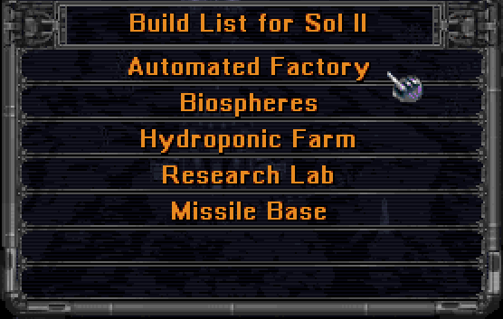
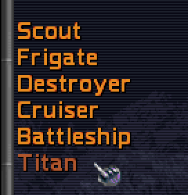

# Manual: Version 2.00 highlights

Version 2.00 restores Master of Orion II as a native application and retains supported player-visible corrections and extensions. The following sections summarize confirmed features rather than every restored rule or fix.

## Platform and presentation support

The game runs in a native, resizable window on Windows, OS X/macOS, and Linux. Fullscreen display, vertical synchronization, and presentation scalers can be selected to suit the display and system.

The interface includes optional map overview markers and influence views, additional empire and research information, and configurable animation, scrolling, and fade behavior.

## Larger galaxies

Version 2.00 supports galaxies larger than those available in the original game. Larger maps provide more room for exploration and expansion, but may make turns and games take longer.

## Configuration and mods

The `data/orion2re.cfg` configuration file contains settings that change how the game looks, responds, and plays. For example, players can select display and interface behavior, adjust new-game and galaxy rules, and change rules for colonies, research, ships, combat, diplomacy, espionage, leaders, and events. The file can be edited with a text editor. The [configuration reference](../../generated/configuration/index.md) explains each setting, its accepted values, and its default.

Mods provide a prepared collection of changes instead of requiring players to configure each rule separately. A mod may change game rules, replace game data, or add scripts. Mods are installed in `data/mods` and enabled by name in `data/orion2re.cfg`. Version 2.00 includes optional packages for restored 1.50 behavior and related rule sets. Installed mods are not active until they are enabled, and some mods require other mods or cannot be used together.

## Multiplayer

Version 2.00 supports Network, Online, and Hotseat games. Network players must use matching game builds and compatible configuration, mod packages, and scripts. The game checks this information before play to avoid known sources of differing game state.

## Random Number of Opponents

It’s now possible to start a new game with a random number of AI opponents. In single player games 1-7 AI’s are added, and in multiplayer games 0-6 AI’s are added.

## Build Queue Management

Eleven configurable queue presets reduce colony micromanagement. They are bound to `Q` and `0` through `9` and can be used in the Build and Colonies screens. In the Colonies screen, hold Shift to apply a preset to every owned colony other than outposts. The built-in presets are:

Q        merge buildings

0        clear the queue

1        prepend ship design 1

2        prepend ship design 2

3        prepend ship design 3

4        prepend ship design 4

5        prepend ship design 5

6        prepend ship design 6

7        prepend freighter

8        prepend spy

9        append housing

The [Build queue management](../user-facing-changes/build-queue.md) page describes current preset configuration, Autobuild, multibuild, limits, and recovery behavior.

## Revert Buy Action

A buy action can now be reverted by pressing the BUY button in the Colony screen, Build screen or Colonies screen. The amount of BC paid will be returned and added production removed.

## 6th Ship Design Slot

A 6th slot for custom design has been added.

## Play with Auto Designed Ships

ALT-AD auto updates all six ship design slots with AI designs. Slot 1 is always a scout ship. In Pre-warp, Average and Post-warp games, the other 5 slots are frigate to titan class until doom star construction technology is known, then they become destroyer to doom star class. On Advanced, slots 2 - 6 are always destroyer to doom star class.
